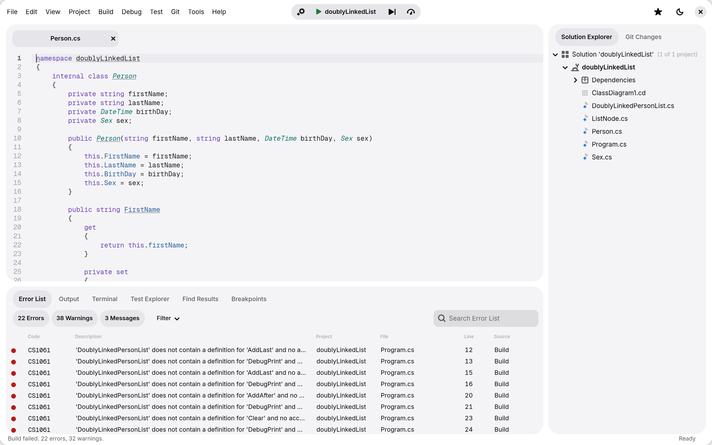
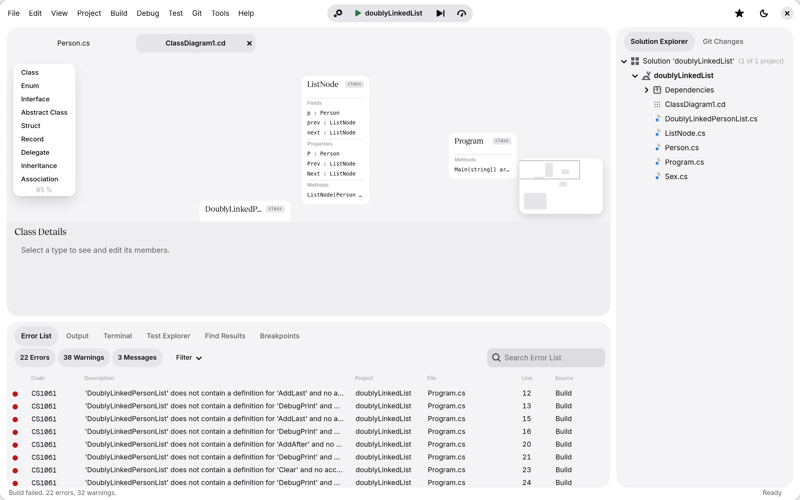
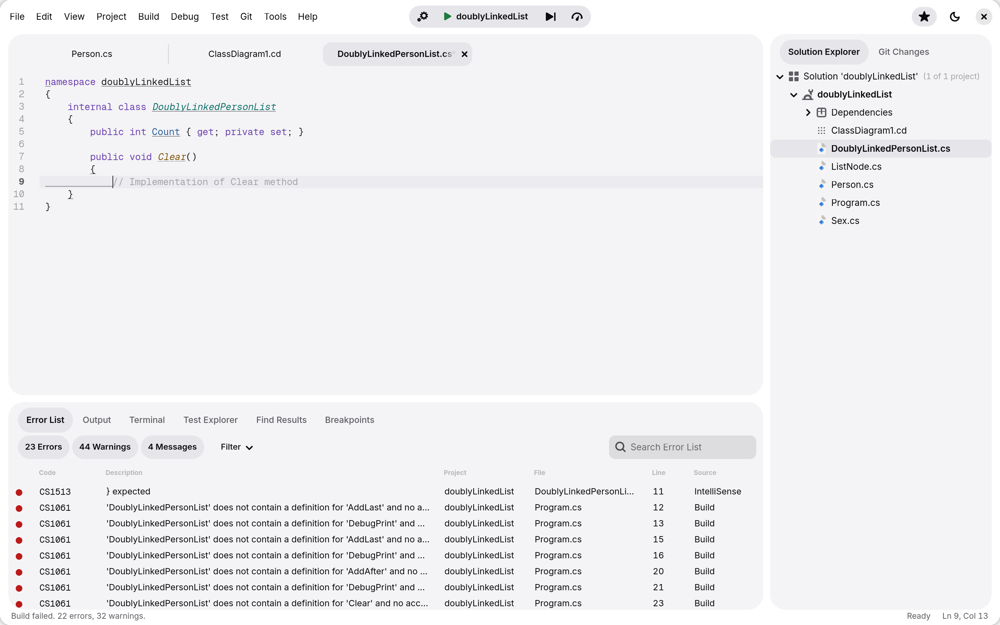
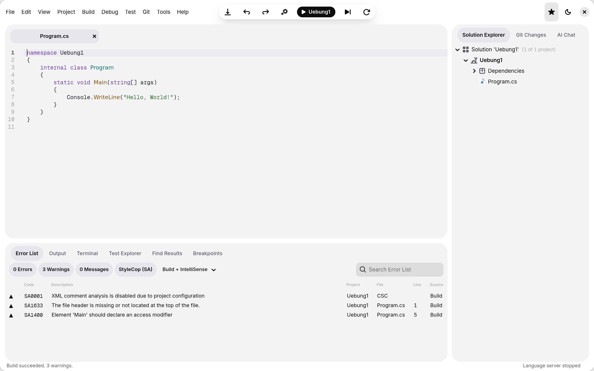
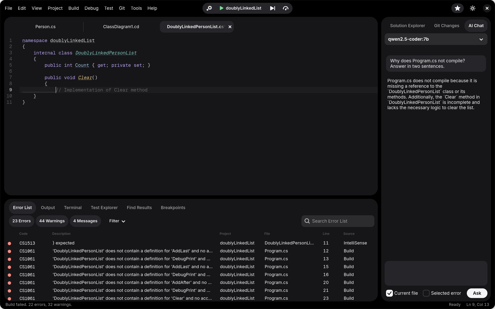
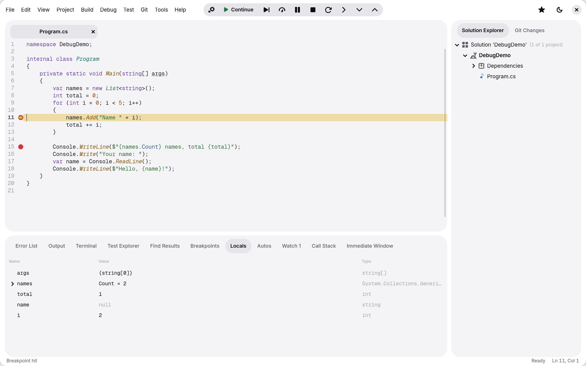
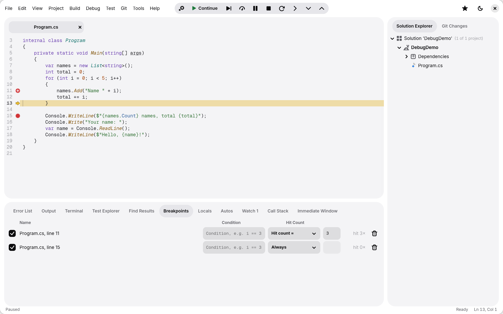
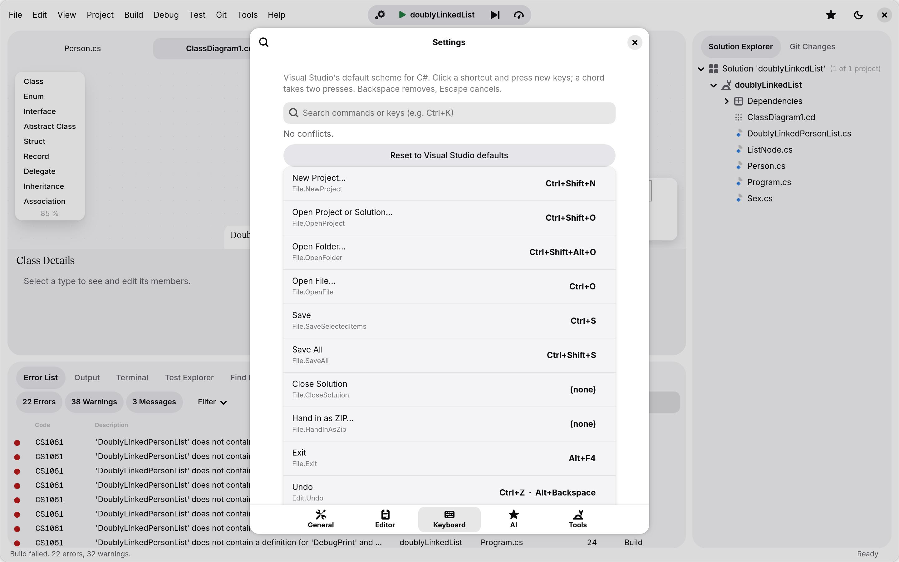
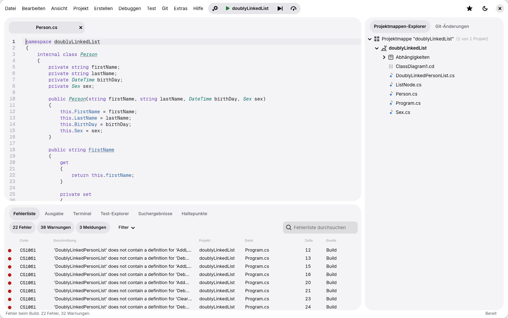
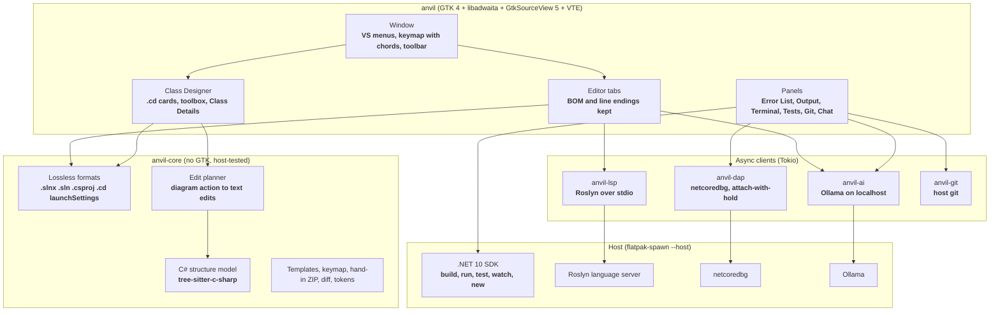

<div align="center">
  
  <h1>Anvil</h1>
  <p><strong>A C# IDE for Linux that writes every file the way Visual Studio would, so a solution made on Fedora opens unchanged in Visual Studio 2026. Its own strength is the class diagram, round-tripping Visual Studio's Class Designer files.</strong></p>

  <p>
    
    
    
    
    
    
  </p>
</div>

---



---

## Why

A university that allows only **Visual Studio** checks assignments as **ZIP** files with **StyleCop.Analyzers**. **Anvil** lets that work happen on **Linux**: it opens the **`.slnx`/`.sln`**, edits, builds, runs, tests and debugs it, and hands in a ZIP that **Visual Studio 2026** opens, builds with the same warnings and does not ask to save. No Windows PC was available while building it, so compatibility is proven against **real files Visual Studio wrote** (the course assignment `doublyLinkedList`, kept as test fixture).

Every claim below says how far it goes: ***tested*** (and how), ***built*** (compiles, not run here) or ***planned***.

<table>
  <tr>
    <td></td>
    <td></td>
  </tr>
  <tr>
    <td></td>
    <td></td>
  </tr>
  <tr>
    <td></td>
    <td></td>
  </tr>
  <tr>
    <td></td>
    <td></td>
  </tr>
</table>

---

## Architecture Overview

**Anvil** is a **Rust** workspace. Everything that is a format or a rule lives in **`anvil-core`**, has no GTK, and is unit-tested on the host. The GTK app talks to **Roslyn**, **netcoredbg**, **Ollama** and **git** through async clients on a **Tokio** runtime; the GTK main thread only draws and handles input. In the **Flatpak**, `dotnet`, Roslyn, netcoredbg, git and the user's program run on the host through **`flatpak-spawn --host`**, so the user's SDK, NuGet cache and git configuration apply.



---

## Visual Studio Compatibility

| Area | State | Evidence |
| :--- | :--- | :--- |
| **`.slnx`, `.sln`, `.csproj`** read and written losslessly | ***tested*** | unchanged files give identical bytes; a changed property changes one element (unit tests on the course files and SDK-written samples) |
| **`.cd` class diagrams** | ***tested*** | course `ClassDiagram1.cd` round-trips byte for byte; moving a card changes only its `<Position>`; unknown elements survive |
| **`.cd` HashCode** | ***partly*** | structure reconstructed from 645 types (one bit per member name, constructors excluded); the name-to-bit function is **not** reproduced. Anvil never rewrites a hash VS wrote and computes one only for empty types or names it has learned. Whether VS then wants to save a diagram with a new type is **not verified** |
| **New Class** (Add → Class) | ***tested*** | byte-identical to the course's VS-written `DoublyLinkedPersonList.cs` (BOM, CRLF, no final line break) |
| Interface, Enum, Struct, Record items | ***built*** | follow the class shape; *not verified against VS* |
| **Console App with StyleCop** (New Project) | ***tested*** | `dotnet new console` + Anvil's StyleCop block gives the course's `.csproj` byte for byte (unit test, and a real New Project run from the Flatpak that then built with the expected SA warnings) |
| **`Program.cs`** of a new Console App | ***tested*** | block namespace and `internal class Program` as in the course's VS-written file (the SDK template writes a file-scoped namespace; Anvil writes VS' shape) |
| `dotnet sln add` on Linux writes LF | ***tested*** | Anvil restores the solution's own BOM and CRLF afterwards |
| **StyleCop warnings** equal to VS | ***tested*** | `dotnet build` from inside the Flatpak lists the course's SA warnings in the Error List; live squiggles need Roslyn (below) |
| **Hand in as ZIP** | ***tested*** | ZIP of the course without `bin/`, `obj/`, `.vs/` and `.gitignore`d files, names in UTF-8 |
| Class Designer member stubs (`throw new NotImplementedException();`) | ***built*** | *not verified against VS* |

---

## Core Capabilities

- **Solution Explorer:** solution, solution folders, projects, **Dependencies** (frameworks, packages, project references), folders and files as SDK globbing sees them; VS' context menus: **Add → New Item / Existing Item / Class / New Folder / Class Diagram**, **Rename (F2)**, **Delete** (to the trash), **Exclude From Project** (`<Compile Remove>` written losslessly), **Set as Startup Project**, **Properties (Alt+Enter)**, **Open Folder in File Manager**, **Open in Terminal**. *Tested* (screenshot run on the course).
- **Editor:** GtkSourceView in **Cascadia Mono**, Visual Studio's own code font, with a muted palette for light and dark (every colour 4.5:1 or more on its ground). Type and method names are found in the syntax tree (tree-sitter, before and without Roslyn) and set in Cascadia's cursive italic (`ss01`), as VS Code themes set them; it has the same advance, so columns stay straight. Only the changed part of the buffer is re-tagged after an edit. Preview tab on single click, find and replace, **Find in Files**, **Go To All (Ctrl+T)**, **Go To Line (Ctrl+G)**, comment/uncomment chords, line move, duplicate, VS snippets (`prop`, `ctor`, `for`, `cw`, `svm`, … + **Tab**, then Tab from field to field; linked fields are not updated together), navigation history. Files changed on disk (a git switch, NuGet, another editor) reload in tabs without edits; a tab with edits asks first. Encoding and line endings of each file are kept; new lines in a CRLF file are CRLF. *Tested* (unit tests for text handling, snippets and the name highlighter; editor shown in the screenshot run).
- **IntelliSense from Roslyn:** completion, signature help, squiggles, Quick Info, **F12 / Alt+F12 / Ctrl+F12 / Shift+F12**, **Rename (Ctrl+R, Ctrl+R)**, **Quick Actions (Ctrl+.)** including StyleCop's code fixes, **Format Document (Ctrl+K, Ctrl+D)**, document outline. Server: `Microsoft.CodeAnalysis.LanguageServer` **5.4.0-2.26179.14** from Microsoft's `vs-impl` feed, downloaded once with consent. Diagnostics are *tested*: in a screenshot run on this PC Anvil started the downloaded server, and its StyleCop warnings for the open file reached the Error List as IntelliSense entries; after the run typed into a file, the server stayed up and answered with a fresh diagnostic for the edit (`CS1513`). Completion, navigation, rename and code fixes are ***built***; the client protocol is *tested* against a scripted server.
- **Build and run:** **Build / Rebuild / Clean (Ctrl+Shift+B)** through `dotnet build`, Output window, **Error List** with Errors/Warnings/Messages counters and one **Filter** menu (Build + IntelliSense, StyleCop SA rules). **Ctrl+F5** runs the built program in the terminal panel (**VTE**), in its output folder with the arguments and environment of `launchSettings.json`, with VS' "Press any key to close this window . . .", so `Console.ReadLine` works. **Hot Reload** through `dotnet watch`. *Tested* for build and Error List (screenshot run); Ctrl+F5 and Hot Reload *built*.
- **Debugger (F5):** netcoredbg **3.2.0-1092** (MIT, downloaded once with consent). netcoredbg's DAP mode gives a launched program no input and its server mode listens on every network interface, so Anvil uses **attach-with-hold**: the program runs in the terminal panel with a small .NET startup hook (built once with the user's SDK) that waits for the debugger; netcoredbg attaches over stdin/stdout, gets the breakpoints, and the program runs with a real console. Breakpoints follow the code when lines are inserted above them and are drawn as VS draws them (set, disabled, with condition or hit count, not bound). The **Breakpoints** window has VS' columns: condition, hit count (*=*, *≥*, *multiple of*; counted by Anvil, because netcoredbg ignores DAP's `hitCondition`) and the hits so far. **Locals / Autos / Watch** are Name · Value · Type trees, collections show `Count = n`, values that changed since the last stop are red; **DataTips** on hover work with or without Roslyn. **F10 / F11** without a session stop at the start of `Main`; Shift+F11, Ctrl+F10, Call Stack, Immediate, QuickWatch, exception settings. *Tested* on this PC with a screenshot run against the real netcoredbg: a breakpoint with hit count 3 stopped on the third pass, Locals showed `names` as `Count = 2`, two steps changed `Count = 3` and `total`, Continue reached the second breakpoint, then the program read a name typed in the terminal and exited with code 0. Changed-value colouring, DataTips, QuickWatch and Debug Test are *built*.
- **Class Designer:** VS `.cd` files as cards with **Fields / Properties / Methods / Events / Nested Types** compartments (fold like VS), members in VS' **MembersFormat**, inheritance lines, associations, lollipops for interfaces, zoom, pan (drag the right mouse button anywhere, or the left or middle one on empty canvas; a right click without movement opens the context menu), minimap, export **PNG / SVG / PDF**. Toolbox and context menus **Add → Class / Enum / Interface / Abstract Class / Struct / Record / Delegate / Comment** and **Add → Method / Property / Field / Event / Constructor / Destructor / Constant** become code through the edit planner as one undo step; **Class Details** edits name, type and access in place; **Delete** asks *Remove from Diagram* or *Delete Code*; drag a `.cs` file in from the Solution Explorer. The cards follow code edits within 150 ms. *Tested* for the planner (unit tests on the course files) and the diagram view (screenshot run); the interactive actions, right-drag panning included, are *built*.
- **Test Explorer:** MSTest, xUnit and NUnit tests found in the code, run with `dotnet test` (VSTest or Microsoft.Testing.Platform), TRX results, pass/fail/skip with duration, message and stack; **Ctrl+R, A**, run failed, repeat last, debug a test. TRX parsing and discovery *tested*; the panel *built*.
- **Git:** Git Changes with stage/unstage, **Undo Changes**, commit and amend, a repository root above the solution (one repository per course), branches (create, switch, merge), fetch/pull/push, history, side-by-side diff in `up`/`down`, **Create Git Repository** with VS' `.gitignore`. Parsers *tested*; panel *built*.
- **NuGet Package Manager:** Browse (nuget.org search), Installed, Updates, version picker, install/update/uninstall through `dotnet add/remove package` (latest stable version unless prereleases are switched on) with the project file's BOM and line endings kept. Parsers *tested*; dialog *built*.
- **AI (Ollama only, off by default):** grey ghost text after the caret, **Tab** accepts, **Ctrl+Right** a word, **Esc** dismisses; a chat whose code changes arrive as patches reviewed per file and per hunk. One **AI off** switch for exams. *Tested* on this PC: ghost text from `qwen2.5-coder:7b` and a streamed chat answer inside the Flatpak (screenshot run); the patch review is *built*.
- **German and English:** following the system or pinned in Settings, with VS' words (*Projektmappen-Explorer*, *Fehlerliste*, *Ausgabe*). 566 of 566 strings translated. *Tested* (`msgfmt -c`, and a German screenshot run). Compiler messages stay English, because Anvil reads `dotnet`'s output.

---

## Keyboard

The complete set of Visual Studio default C# bindings Anvil has commands for, with two-key chords. One key controller in the capture phase sees every key first, so GTK's own shortcuts (`Ctrl+.` emoji insertion) do not get in the way. Every binding can be changed in **Settings → Keyboard**; overrides go to `keymap.json`. *Tested*: every default binding parses and the scheme has no conflicts (unit test).

| Command | Linux | Command | Linux |
| :--- | :--- | :--- | :--- |
| **Build Solution** | `Ctrl+Shift+B` | **Format Document** | `Ctrl+K, Ctrl+D` |
| **Start Debugging** | `F5` | **Comment / Uncomment** | `Ctrl+K, Ctrl+C` / `Ctrl+K, Ctrl+U` |
| **Start Without Debugging** | `Ctrl+F5` | **Rename** | `Ctrl+R, Ctrl+R` or `F2` |
| **Step Over / Into / Out** | `F10` / `F11` / `Shift+F11` | **Quick Actions** | `Ctrl+.` |
| **Toggle Breakpoint** | `F9` | **Go To Definition / Peek** | `F12` / `Alt+F12` |
| **Run All Tests** | `Ctrl+R, A` | **Find All References** | `Shift+F12` |
| **Add New Item** | `Ctrl+Shift+A` | **Go To All / Line** | `Ctrl+T` / `Ctrl+G` |
| **Add Class** | `Shift+Alt+C` | **Error List** | `Ctrl+\, Ctrl+E` |

macOS and Windows are not targets: Anvil is a Linux answer to a Windows-only rule.

---

## Data on Disk

| What | Where |
| :--- | :--- |
| **Settings** | GSettings `io.github.tomsliikee.Anvil` |
| **Keymap overrides, logs** | **`~/.var/app/io.github.tomsliikee.Anvil/config/anvil/`** |
| **Per-solution state** (startup project, open tabs, breakpoints, watches, diagram zoom, test results) | **`.vs/anvil/`** in the solution folder (left out of the hand-in ZIP, never in a project folder) |
| **Roslyn, netcoredbg** | **`~/.local/share/anvil/`** on the host |

Network: the two first-start downloads (with consent), nuget.org in the package manager and `dotnet restore`, git remotes. AI talks to `localhost` only; other addresses are refused.

---

## Platform Support

| Platform | State |
| :--- | :--- |
| **Fedora 44**, GNOME, Flatpak on GNOME 51 runtime | ***tested*** (installed, opened the course assignment, built it, screenshots) |
| Other distributions with Flatpak | ***planned*** |
| macOS, Windows | not a target |

The host needs **Flatpak** and the **.NET 10 SDK**; Anvil says so plainly when `dotnet` is missing.

---

## Build

**Once:**

```bash
flatpak install --user flathub org.gnome.Sdk//51 org.gnome.Platform//51 org.freedesktop.Sdk.Extension.rust-stable//26.08
```

| Does | Command |
| :--- | :--- |
| **Test the GTK-free crates on the host** | `cargo test` |
| **Check everything in the SDK** (needs `target-sdk/deps/prefix` with VTE, see below) | `tools/sdk.sh cargo clippy --workspace --all-targets -- -D warnings` |
| **Build and install the Flatpak** | `flatpak-builder --user --install --force-clean --disable-rofiles-fuse build-dir build-aux/io.github.tomsliikee.Anvil.json` |
| **Run** | `flatpak run io.github.tomsliikee.Anvil` |
| **Refresh translations** | `tools/sdk.sh tools/update-po.sh` |

The GNOME 51 runtime has no VTE; the manifest builds **VTE 0.84.1** as a module. For SDK builds outside flatpak-builder, VTE is built once into `target-sdk/deps/prefix` (meson in the SDK, the same options as the manifest) and `tools/sdk.sh` puts it and the bundled fonts on the paths.

**Screenshot mode:** with `ANVIL_SCREENSHOT=<dir>` and `ANVIL_OPEN=<solution>` Anvil walks through itself and writes PNGs at 2x: start page, editor, Error List after a build, class diagram, Add New Item, Settings → Keyboard, ghost text, chat, dark. `ANVIL_SHOTS=ui` takes the quick pass instead (no build, no AI): four files opened as preview tabs in a row, the diagram, New Project, New Item and Settings in light and dark. `ANVIL_SHOTS=debug` with a `DebugDemo` solution (a loop at line 11, `Console.ReadLine` at line 17) runs F5 for real: breakpoint with hit count, Locals, steps, Watch, Breakpoints, Call Stack, input in the terminal, end of the program. `ANVIL_CONFIG_DIR` keeps such runs out of the real configuration, and a screenshot run is always its own process, never a window of a running Anvil.

```bash
flatpak run --env=ANVIL_SCREENSHOT=$PWD/readmestuff/shots --env=ANVIL_OPEN=$PWD/target-sdk/shots/course/doublyLinkedList.slnx io.github.tomsliikee.Anvil
```

---

## Known Gaps

- **`.cd` HashCode function** not reproduced (see the compatibility table); the research and its rejected candidates are in `crates/anvil-core/src/hashcode.rs`.
- Of **Roslyn** only the diagnostics were seen; completion, navigation, rename and code fixes are *built*, not *tested*. Roslyn now restarts once by itself after a crash (**Tools → Restart Language Server** otherwise).
- **Snippets** update only the first of linked fields (VS updates all); completion items are not resolved, so no documentation and no automatic `using`.
- **Git** cannot ask for credentials (HTTPS remotes need a credential helper or SSH) and has no conflict view.
- **Multi-caret** editing is not offered (GtkSourceView 5 has none); **Edit and Continue** under the debugger is not available (netcoredbg has none; Hot Reload runs without the debugger).
- **Split view** of one file and **CodeLens/blame** in the gutter (*planned*; their settings are hidden until then).

---

## License

MIT. Fonts: **Inter**, **Geist Mono**, **Geist Serif** and **Cascadia Mono** (Microsoft, v2407.24) under the SIL Open Font License (`insights-mono/fonts/`). The debugger is Samsung's **netcoredbg** (MIT), downloaded on first use.
